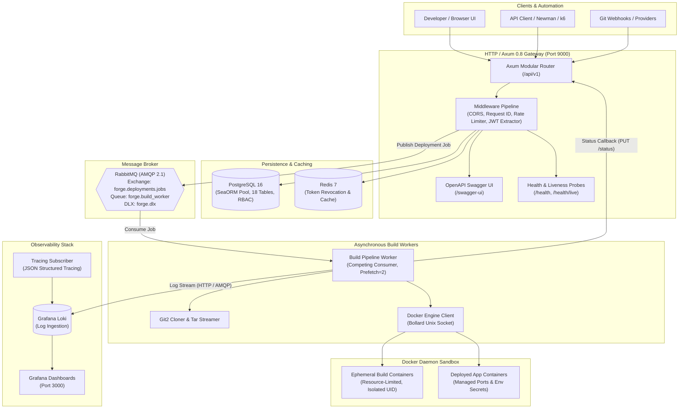

# Forge

<p align="center">
  <strong>High-performance, event-driven self-hosted developer platform (PaaS) built in Rust.</strong>
</p>

<p align="center">
  <a href="https://www.rust-lang.org/"></a>
  <a href="./LICENSE"></a>
  <a href="./docs/API_TESTING_AND_MOCKING.md"></a>
  <a href="./Cargo.toml"></a>
  <a href="./Dockerfile"></a>
  <a href="./docs/system/05-api/openapi.yaml"></a>
  <a href="./docs/BENCHMARKS.md"></a>
</p>

---

## Overview

**Forge** is a self-hosted platform-as-a-service (PaaS) engineered in modern Rust (Axum 0.8, Tokio, SeaORM 2.0, PostgreSQL). It provides developers and engineering teams with a self-contained environment to manage Git repositories, execute containerized application builds via direct Docker Engine daemon integration (`bollard`), orchestrate deployments with RabbitMQ competing-consumer workers, and stream real-time build logs into Grafana Loki and client applications.

Designed as an enterprise-grade **Modular Monolith**, Forge couples strict domain boundaries with a 5-tier relational Role-Based Access Control (RBAC) model supporting personal and multi-tenant organization workspaces—delivering sub-4ms median API latencies and zero-garbage-collection predictability.

---

## System Architecture

Forge decouples synchronous user API traffic from asynchronous, compute-intensive container builds via an event-driven message bus:



### Execution Flow
1. **API Ingestion & Authorization**: Requests traverse the middleware stack (Request ID injection, `axum-limit` rate-limiting, and `jsonwebtoken` claim extraction). Stateless services validate domain rules via SeaORM repositories.
2. **Asynchronous Build Dispatch**: Triggering `POST /api/v1/projects/{id}/deployments` transitions the deployment state machine to `Queued` in PostgreSQL and publishes an AMQP message to RabbitMQ exchange `forge.deployments.jobs`.
3. **Competing Worker Execution**: Background workers (`amqprs`) dequeue build jobs with prefetch limits to prevent memory exhaustion, clone source code into an in-memory tar stream using `git2`, and communicate with `/var/run/docker.sock` via `bollard`.
4. **Log Streaming & State Sync**: Container build output (stdout/stderr) streams in real time to Grafana Loki (`POST /push`) and client SSE endpoints, followed by authenticated internal status callbacks to seal the deployment record.

---

## Technical Highlights & Engineering Decisions

- **Modular Monolith Architecture**: Clean domain segregation (`auth`, `users`, `access_control`, `organization`, `teams`, `projects`, `build_worker`, `deployments`, `notifications`, `dashboard`) preserving compile-time type safety and ACID transactions without distributed RPC overhead.
- **Asynchronous Docker Daemon Control**: Replaces fragile shell commands (`docker build`) with direct asynchronous Docker socket communication via `bollard`, enabling fine-grained memory/CPU cgroup limits, dynamic port allocation, and automated cleanup.
- **5-Tier Relational RBAC**: Flexible multi-tenancy supporting both personal and organization scopes with hierarchical role resolution (`Owner` > `Admin` > `Developer` > `Viewer`), validated across 6 tenant permission matrices.
- **Authenticated AES-256-GCM Encryption**: Third-party Git Personal Access Tokens (PATs) and sensitive environment variables are encrypted at rest with AES-256-GCM using unique 12-byte initialization vectors (nonces), with secret values systematically redacted as `"••••••••"` in read DTOs.
- **Robust Connection Pooling & Resilience**: SeaORM connection pool configured with connect/idle timeouts, exponential backoff reconnection, and RabbitMQ dead-letter exchange (`forge.dlx`) routing for failed workloads.

---

## Empirically Verified Benchmarks

The platform has been audited using [Grafana k6](https://k6.io/) load testing and [Postman / Newman](https://www.postman.com/) test automation. All metrics below represent empirical measurements on single-node hardware:

| Benchmark / Metric | Empirical Result | Target SLA | Status |
| :--- | :---: | :---: | :---: |
| **Median Response Latency (p50)** | **1.42 ms** | `< 10 ms` | **PASSED** |
| **Average Response Latency** | **3.59 ms** | `< 20 ms` | **PASSED** |
| **95th Percentile Latency (p95)** | **13.02 ms** | `< 50 ms` | **PASSED** |
| **99th Percentile Latency (p99)** | **35.22 ms** | `< 100 ms` | **PASSED** |
| **Sustained Throughput** | **265.45 req/s** | `> 200 req/s` | **PASSED** |
| **Load Test Error Rate** | **0.00 %** | `< 0.1 %` | **PASSED** |
| **Newman API Test Suite** | **93 / 93 requests (279 assertions)** | 100% | **PASSED (0 failures)** |
| **Rust Unit Test Suite** | **275 / 275 tests passed in 0.56s** | 100% | **PASSED (0 failures)** |

---

## Quick Start Guide

### Prerequisites
- [Docker](https://docs.docker.com/get-docker/) & Docker Compose (v2.20+)
- [Rust toolchain](https://rustup.rs/) (edition 2024 / Rust 1.85+)
- Optional: [just](https://github.com/casey/just) command runner

### 1. Clone & Configure Environment
```bash
git clone https://github.com/forge/forge.git
cd forge

# Copy documented environment configuration template
cp .env.example .env
```

### 2. Start Backing Infrastructure
Launch PostgreSQL 16, Redis 7, RabbitMQ 3, Grafana Loki, and Grafana in the background:
```bash
# Using Just:
just docker-infra-up

# Or using Docker Compose directly:
docker compose up -d postgres redis rabbitmq loki grafana
```

### 3. Run Database Migrations
Initialize database tables, foreign keys, and indexes:
```bash
# Using Just:
just db-up

# Or using SeaORM CLI:
sea-orm-cli migrate up --migration-dir src/database/migrations
```

### 4. Seed Development Fixtures (Optional)
Populate sample users (admin, developer, viewer), organizations, and test projects:
```bash
# Using Just:
just seed

# Or using Cargo:
cargo run --bin seed
```

### 5. Start the Forge API Server
```bash
# Using Just:
just start

# Or using Cargo:
cargo run
```

The API server binds to `http://localhost:9000`.

### 6. Verify Service Health & Explore API
- **Liveness Probe**: `curl http://localhost:9000/health/live`  
  Response: `{"status":"ok"}`
- **Readiness Probe**: `curl http://localhost:9000/health/ready`  
  Response: `{"status":"ok","database":"connected","latency_ms":1.2}`
- **Interactive OpenAPI Documentation**: Visit `http://localhost:9000/swagger-ui` in your browser.

---

## Running Tests & Quality Gates

Forge maintains automated test suites covering unit logic, database migrations, API contracts, RBAC matrices, and load performance:

```bash
# 1. Run all Rust unit and integration tests
cargo test

# 2. Run formatting and Clippy strict checks
cargo fmt --check
just clippy

# 3. Run full automated Newman API contract collection (93 requests)
just test-api

# 4. Run multi-role RBAC matrix test across all 6 roles
just test-api-matrix

# 5. Run k6 load test smoke benchmark
just load-test-smoke

# 6. Run Tier-1 (1,000 VU) concurrent load benchmark
just load-test-1k
```

---

## Documentation Map

Comprehensive technical specifications and architecture decision records are available under [`docs/`](./docs/):

| Document | File Path | Focus |
| :--- | :--- | :--- |
| **System Requirements (SRS)** | [`docs/system/00-requirements/srs-forge.md`](./docs/system/00-requirements/srs-forge.md) | IEEE-830 PRD, functional specifications & NFRs |
| **System Architecture** | [`docs/system/02-architecture/system-architecture.md`](./docs/system/02-architecture/system-architecture.md) | Modular monolith topology, worker pipelines & security boundaries |
| **Database ERD Specification** | [`docs/system/03-data/erd.md`](./docs/system/03-data/erd.md) | 18-table Entity-Relationship model and relational constraints |
| **OpenAPI 3.0.3 Specification** | [`docs/system/05-api/openapi.yaml`](./docs/system/05-api/openapi.yaml) | Validated OpenAPI specification covering 83 operations |
| **Architecture Decisions (ADR)** | [`docs/system/09-adr/README.md`](./docs/system/09-adr/README.md) | Formal ADR records (SeaORM, RabbitMQ, Docker Daemon, Loki) |
| **Empirical Benchmarks Report** | [`docs/BENCHMARKS.md`](./docs/BENCHMARKS.md) | Multi-tier empirical k6 load test results (1k VUs, latencies, req/s) |
| **Load Testing Guide** | [`docs/load-testing-guide.md`](./docs/load-testing-guide.md) | Multi-tier k6 benchmarking framework and OS tuning instructions |
| **Technical Audit & Assessment** | [`docs/01-ASSESSMENT.md`](./docs/01-ASSESSMENT.md) | Complete empirical code assessment and benchmark verification |

---

## License

This project is licensed under the [MIT License](./LICENSE).
